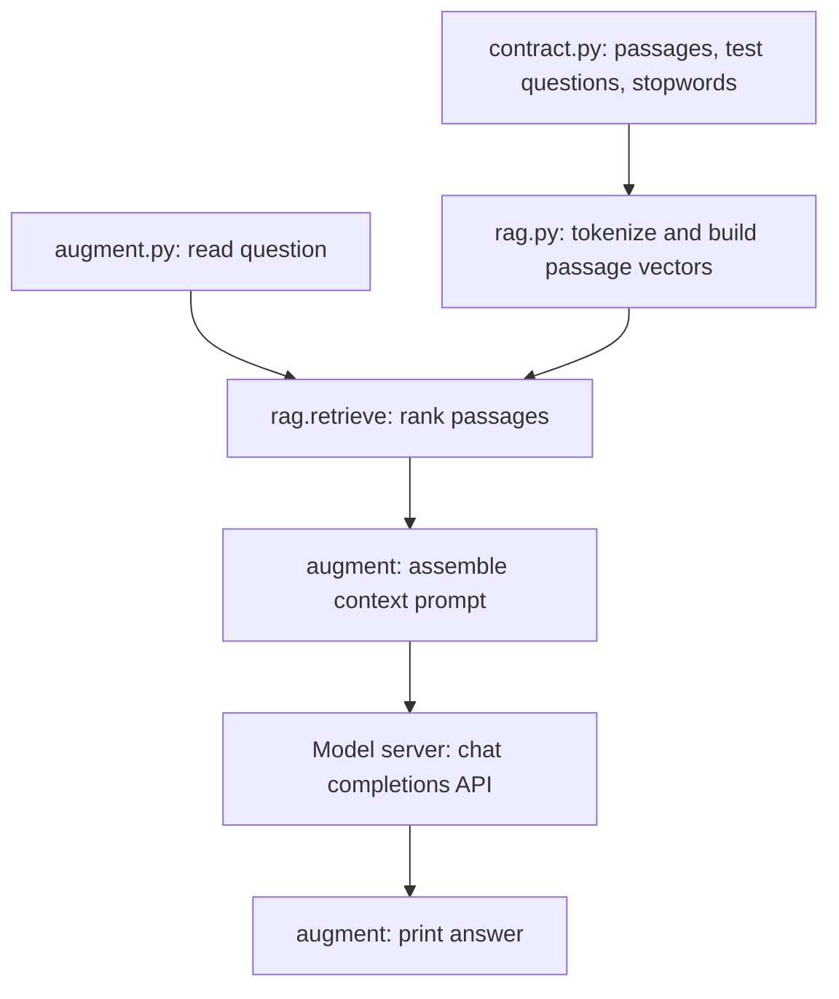

**Architecture**
This is a small, single-process RAG demo. The contract is stored directly in Python, retrieval is done locally with NumPy, and a separate local model server generates the answer. There is no vector database or external embedding model.

**Files and responsibilities**

- [contract.py](contract.py) is the data source. `pieces` contains the agreement clauses; each list position is that clause’s index. `questions` contains sample questions paired with the expected clause index, for retrieval evaluation. `common` is the set of frequent words excluded from the text representation.
- [rag.py](rag.py) builds and uses the retriever. `words()` lowercases text, extracts letter-only words, and removes `common`. `vocab` is the sorted set of remaining words across all contract passages. `embed()` represents text as a word-count vector over that vocabulary and normalizes it. `E` stores one vector per passage. `retrieve()` compares a query vector with every passage vector and returns the indexes of the top matches.
- [augment.py](augment.py) coordinates the live question-and-answer flow. `main()` gets a question from the command line or interactive input. `augment()` calls the retriever, selects the matching `pieces`, and puts those passages and the question into a prompt. `generate()` sends the prompt to the configured chat-completions endpoint and extracts the returned assistant content.

**What happens when you run it**

1. Python starts `augment.py` and imports `pieces` and `retrieve` from `rag.py`.
2. Importing `rag.py` also imports the data from `contract.py`, builds `vocab` and `E`, and computes the sample `hit` evaluation list.
3. `main()` reads the question.
4. `augment()` asks `retrieve()` for two passage indexes by default, then builds a prompt instructing the model to answer only from those passages.
5. `generate()` sends that prompt in a `messages` request to `http://127.0.0.1:9931/v1/chat/completions` by default. `LLAMA_HOST` and `LLAMA_MODEL` can override the endpoint and model.
6. The model server returns a chat-completion response. `generate()` extracts `choices[0].message.content`, and `main()` prints it.

**How retrieval ranks passages**

Each passage and query is represented using the same vocabulary. A vector’s entries are word counts, normalized to unit length. The dot product between a normalized query vector and each normalized passage vector is cosine similarity:

$$
\operatorname{similarity}(q,p_i)
=
\frac{v_q \cdot v_i}{\|v_q\|\|v_i\|}
$$

`retrieve()` sorts those scores from highest to lowest and returns the corresponding passage indexes. This is a simple lexical retriever: it rewards shared words, not conceptual similarity.

**Evaluation versus answering**

`rag.py`’s `hit` list evaluates whether the *first* retrieved passage matches each expected index in `questions`. Its score is printed only when you run `rag.py` directly. Running `augment.py` does not print that score; it uses the retriever for your live question instead.

**Important limitations**

- If a query contains no words in the contract vocabulary, its vector is all zeros. Similarity scores then tie, so retrieval may return the first passages rather than relevant ones.
- The model only sees the two retrieved passages. If retrieval misses the relevant clause, the model can give a wrong answer even when the clause exists in `contract.py`.
- The current prompt and API call make one request per question; there is no chat history, streaming, or source citation.
- The response parser expects the server to return the OpenAI-compatible `choices[0].message.content` structure. A missing or empty content value can lead to an empty printed answer.